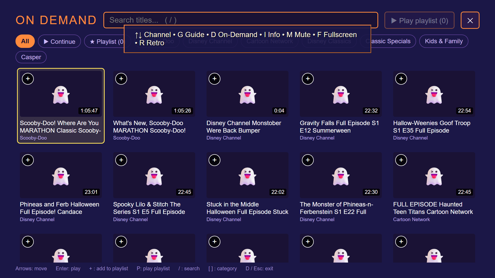
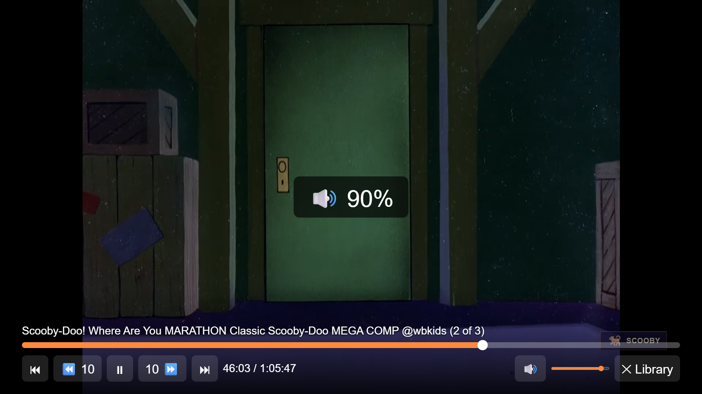

# Spooky Cable — Retro 90s Cable TV Simulator

A fully-functional cable TV experience in your browser. Live channels with schedule-based playback, an interactive Prevue-style program guide, and an on-demand library—all wrapped in authentic CRT scanlines and retro UI. A fun Halloween project recreating the golden age of channel surfing.

**Current capabilities:** 9 themed Halloween channels · Schedule-accurate playback with HTTP Range seeking · Picture-in-picture interactive guide · On-demand library with playlists · Resume playback · Full video player controls · Retro CRT aesthetic with scanlines · All client-side, no backend required

## The Problem

Remember when "what's on TV" meant flipping through channels or browsing a scrolling program guide? Modern streaming assumes you know exactly what you want to watch. There's no discovery through surfing, no surprise finds, no shared schedule—everyone watches different things at different times.

And building a realistic cable TV simulator is harder than it looks:
- Video players don't seek to mid-video positions when changing channels (they restart from 0:00)
- Standard HTTP servers don't support Range requests, breaking video seeking entirely
- Scheduling continuous programming across multiple "channels" requires time-based math
- Real 90s cable guide UIs (Prevue Guide) had specific interaction patterns that modern apps don't replicate

## What Spooky Cable Does

- **Live channel playback** — 9 themed channels (Scooby-Doo, Disney, Cartoon Network, etc.) with continuous looping schedules. When you tune to a channel, the video seeks to where the program "would be" right now based on schedule math.
- **HTTP Range request server** — Custom Python server supports byte-range requests so videos can seek mid-file. Without this, every channel change would restart the video from 0:00.
- **Interactive Prevue-style guide** — Picture-in-picture guide with the current video playing in the corner while you browse. Arrow keys to navigate, click-to-tune, auto-scrolling grid.
- **On-demand library** — Thumbnail grid of all content, search by title/channel, build playlists, resume playback from where you left off. Full video player with seek bar, volume, 10-second skip.
- **Retro CRT aesthetic** — Scanlines, vignette, retro fonts, static burst effects, channel watermarks. Press R to toggle retro mode.
- **Authentic 90s UI patterns** — Channel number overlays, info banners with "Up Next" sections, mini guide pop-ups, volume bars, all styled like real 90s cable boxes.


*On-demand library with thumbnail grid, search, and playlists*


*Full-featured video player with seek bar, volume, and playlist controls*

## How It Works — From Power-On to Playback

### 1. Media Setup

Place video files (`.mp4`) in channel folders under `../media/`:

```
media/
├── scooby-doo/
├── disney-halloween/
├── cartoon-network/
├── disney-classics/
├── classic-specials/
├── kids-family/
├── casper/
└── adult-swim/
```

Run `python generate_index.py` to scan all videos and build `media/index.json` — this catalogs each file's path, title, and duration.

### 2. Schedule Engine

Each channel has a looping schedule based on total video duration. Example:

- Channel has videos A (30min), B (45min), C (60min) → total loop: 135 minutes
- You tune in at real-world time 8:15 PM
- App calculates: `(current epoch time) % (135 minutes)` → you're 42 minutes into the loop
- Video A is 0-30min, B is 30-75min → you're in video B at timestamp 12:00

The app calls `video.currentTime = 12*60` and starts playback there.

### 3. HTTP Range Requests (The Critical Part)

Setting `video.currentTime` only works if the server supports HTTP Range requests. When the browser seeks to 12:00 in a video, it sends:

```
GET /media/channel/video.mp4
Range: bytes=2000000-
```

The server must respond with `206 Partial Content` and the requested byte range. Python's built-in `http.server` doesn't do this — it always sends the full file from byte 0, so seeking fails and videos restart.

**Solution:** `serve.py` — a custom HTTP handler that:
- Parses `Range:` headers
- Seeks to the requested byte offset in the file
- Returns `206` with `Content-Range` header
- Supports cache headers for thumbnails (`.jpg`)

Without this, Spooky Cable would be a fancy video playlist that always restarts videos—not a TV simulator.

### 4. Picture-in-Picture Guide

Press `G` to open the guide. The video shrinks to a corner (`.pip-mode` CSS class) and the scrolling guide fills the screen. Press arrow keys to switch to the interactive grid—the video stays visible in the corner while you browse.

**Implementation:**
- CSS Grid layout with `grid-template-areas`: video on top-left, guide grid below
- Guide has lower `z-index` than video so video stays on top
- Cursor navigation updates `interactiveRow` / `interactiveCol` state, highlights cells
- Clicking a now-airing program tunes to that channel and exits the guide

### 5. On-Demand Module (Zero-Regression Design)

On-demand is a separate module (`ondemand.js` + `ondemand.css`) that **wraps** `app.js` without modifying it. This ensures live TV and guide features never regress when adding new functionality.

**How it works:**
- Loads after `app.js`, extends `SpookyCable.prototype` with new methods
- Intercepts keypress handler to route On-Demand keys (D, Escape, etc.)
- Hijacks the `<video>` element when playing on-demand, hands it back when exiting
- Uses `localStorage` for playlists and resume points
- All selectors start with `.od-` to avoid CSS conflicts

**Why this architecture:**
- Live TV playback uses property handlers (`video.onloadedmetadata = ...`) that must be cleared when On-Demand takes over
- Guide logic scrolls to the current channel and expects specific `activeScreen` states
- Modifying `app.js` to add on-demand would risk breaking these behaviors
- Separate module = isolated testing, easy rollback

## Stack

| Layer | Tech | Why |
|-------|------|-----|
| Frontend | Vanilla JavaScript | No frameworks needed — direct DOM manipulation, Web Audio API for sounds |
| Styling | CSS Grid + Flexbox | Retro TV scaling (1920×1080 canvas scaled to viewport), responsive guide layouts |
| Video | HTML5 `<video>` | Schedule-based `currentTime` seeking, `onended` for auto-advance |
| Server | Python `http.server` + Range support | Custom handler for byte-range requests (critical for mid-video seeking) |
| Storage | `localStorage` | Playlists, resume points, volume preferences — no backend needed |
| Media Index | Python + JSON | `generate_index.py` scans folders, extracts durations via `ffprobe`, outputs `index.json` |
| Testing | Playwright | Automated browser tests for live TV, guide, on-demand (regression suite) |
| Thumbnails | ffmpeg | `make_thumbs.py` extracts a frame from each video (~12% in, avoids intros) |

## Architecture

```
Browser (localhost:8000/tv/)
  ↓
serve.py (HTTP Range request support)
  ├── /tv/*.html, *.css, *.js
  └── /media/*.mp4 (with Range: bytes=... support)
  ↓
index.html
  ├── scale.js (viewport scaling)
  ├── app.js (live TV + guide)
  └── ondemand.js (library + player, wraps app.js)
  ↓
app.js state machine
  activeScreen: 'channel' | 'guide' | 'pipGuide' | 'interactive' | 'onDemand' | 'onDemandPlayer'
  ↓
  ├── Live TV: getCurrentProgram() → schedule math → video.src + video.currentTime
  ├── Guide: buildGuideGrid() → scrolling rows, click-to-tune
  ├── PiP Guide: video.classList.add('pip-mode'), guide overlay
  └── Interactive: arrow key navigation, interactiveRow/interactiveCol state
  ↓
ondemand.js (prototype extension)
  ├── odCatalog() → flattens all channel files into thumbnail grid
  ├── odPlay() → hijacks video element, clears live-TV handlers
  ├── odEnded() → autoplay next in playlist
  └── closeOnDemand() → calls tuneToChannel() to restore live playback
```

## Key Technical Decisions

### Why a custom HTTP server instead of `python -m http.server`?

The built-in server doesn't support HTTP Range requests. When the browser seeks to `video.currentTime = 120`, it sends `Range: bytes=X-` to jump to that position. Without Range support, the server sends the entire file from byte 0, the browser can't seek, and every channel change restarts the video from 0:00. The custom `serve.py` parses the Range header, seeks to the requested byte offset, and returns `206 Partial Content` — enabling mid-video seeking.

### Why calculate schedule positions client-side instead of server-side?

The TV is a single-player experience (no multi-user sync needed). Doing schedule math in JavaScript (`(Date.now() % channelTotalDuration)`) means zero server logic, zero API calls, zero database. The app works entirely offline after the initial page load — just static files and videos. A server-side approach would require polling for "what's playing now" or websockets for updates, adding complexity with no benefit.

### Why put on-demand in a separate file instead of integrating it into `app.js`?

Live TV and guide were already working. Adding on-demand features by editing `app.js` risks breaking existing functionality (regressions). The separate module (`ondemand.js`) wraps `app.js` by extending `SpookyCable.prototype` and intercepting keypresses. It never modifies `app.js` directly. This guarantees:
- Live TV behavior is unchanged (tested via regression suite)
- On-demand can be removed by deleting one file
- Isolated testing (32/35 on-demand tests pass without touching guide code)

The cost: on-demand code can't access `app.js` private variables, so it duplicates some catalog logic (`odCatalog()` mirrors channel file structure). The benefit: confidence that live TV still works.

### Why localStorage for playlists instead of a database?

This is a single-user app with no sharing/sync requirements. localStorage gives instant reads/writes, persists across sessions, and requires zero backend infrastructure. The playlist (`["path1.mp4", "path2.mp4"]`) and resume points (`{ time: 42, duration: 120 }`) are simple JSON blobs — no need for PostgreSQL here.

### Why use epoch-based scheduling instead of a "start time" per channel?

A "start time" approach (e.g., "Channel 3 started playing at 6:00 PM") requires:
- Storing state somewhere (what if you reload the page?)
- Handling server restarts (re-initialize? from when?)
- Dealing with drift (clocks aren't perfect)

Epoch-based math is stateless: `position = (now % totalDuration)`. Every client independently calculates the same result at the same moment. No state to store, no drift, works even if you clone the repo to a different machine.

## Installation

### Prerequisites

- Python 3.7+ (for the server)
- Modern browser (Chrome, Firefox, Edge)
- Optional: `ffmpeg` + `ffprobe` (for generating thumbnails)

### Setup

```bash
# 1. Clone the repository
git clone https://github.com/samuelcooper-dev/spooky-cable.git
cd spooky-cable

# 2. Add video files to media folders
# Create folders: ../media/scooby-doo/, ../media/disney-halloween/, etc.
# Add .mp4 videos to each folder

# 3. Generate the media index
python generate_index.py
# → Creates media/index.json with file paths and durations

# 4. Optional: Generate thumbnails
python make_thumbs.py
# → Creates .jpg thumbnails next to each .mp4 (requires ffmpeg)

# 5. Start the server
python serve.py
# → Listening on http://localhost:8000

# 6. Open in browser
# http://localhost:8000/tv/
```

## Controls

### General
- **Power On:** Any key
- **Channel Up/Down:** ↑ ↓ or Page Up/Down
- **Direct Tune:** Number keys 1-9
- **Last Channel:** Enter
- **Volume:** + - or mouse wheel
- **Mute:** M
- **Info Banner:** I
- **Fullscreen:** F
- **Retro Mode:** R (toggle scanlines)

### Guide
- **Open PiP Guide:** G
- **Interactive Grid:** Arrow keys while in guide
- **Navigate:** ↑ ↓ ← → or click cells
- **Tune to Channel:** Enter or click now-airing program
- **Exit:** Escape or G

### On-Demand
- **Open Library:** D
- **Navigate Grid:** ↑ ↓ ← →
- **Search:** / (focus search box)
- **Play Video:** Enter
- **Add to Playlist:** +
- **Category Chips:** [ ] to cycle

### Video Player (On-Demand)
- **Play/Pause:** Space or K or click video
- **Skip Back/Forward:** J / L or ← →
- **Seek:** Click seek bar or number keys 0-9 (jump to 0%-90%)
- **Volume:** ↑ ↓ or drag slider
- **Mute:** M
- **Next/Previous:** N / P
- **Exit Player:** Escape (returns to library)
- **Exit Library:** Escape again (returns to live TV)

## Project Structure

```
tv/
├── index.html          # Main HTML structure
├── app.js              # Live TV + guide (7,500 lines)
├── style.css           # Retro TV styling
├── ondemand.js         # On-demand module (wraps app.js)
├── ondemand.css        # On-demand styles (.od-* selectors)
├── scale.js            # Viewport scaling for 1920×1080 canvas
├── serve.py            # HTTP server with Range request support
├── config.json         # Network name, personalization
├── make_thumbs.py      # Generate .jpg from videos (requires ffmpeg)
└── shots/              # Screenshots for README

media/
├── index.json          # Auto-generated catalog (paths, titles, durations)
└── [channel]/          # Video folders (scooby-doo, disney-halloween, etc.)
    ├── *.mp4           # Video files
    └── *.jpg           # Thumbnails (generated by make_thumbs.py)
```

## Testing

Three Playwright test suites verify functionality without regressions:

```bash
# 1. Regression test (live TV + guide)
node regression_test.js
# → Verifies channels play, seek correctly, guide works, on-demand exits cleanly

# 2. Guide requirements test
node test_guide_requirements.js
# → 25 checks: cursor positioning, PiP visibility, click-to-tune

# 3. On-demand test suite
node od_test.js
# → 35 checks: library, search, playlists, player controls, autoplay
```

All tests run at 1920×1080 viewport (matches the TV canvas size).

## What I'd Do Next

### High Priority

- **Cloud video hosting** — Right now videos must be local files. Adding support for cloud URLs (S3, B2, etc.) would let you share a "channel lineup" without shipping gigabytes of video. The architecture already supports this (just change `mediaUrl()` to return cloud URLs instead of local paths), but you'd need signed URLs or public buckets.

- **Multi-user watch parties** — WebRTC or websocket sync so multiple people can watch the same channel together with chat. The schedule engine is already deterministic (same epoch time = same video position), so sync is just "everyone tune to channel 3 at 8:00 PM" — no complicated time-drift correction needed.

- **Custom channel builder** — A UI to upload videos, set channel names/logos, and generate a shareable config. Right now you manually create folders and run `generate_index.py` — a web interface would make this accessible to non-technical users.

### Nice-to-Have

- **DVR functionality** — "Record" a program (download the video from cloud storage or mark it for later), build a recordings library, scheduled recordings. Would need persistent storage (localStorage size limits) or a simple backend.

- **Closed captions** — Extract or generate WebVTT subtitles, toggle with C key. Many Halloween specials have accessibility issues — adding captions would fix that.

- **Multiple theme packs** — 80s MTV aesthetic, 2000s digital cable, black-and-white 50s TV. The retro mode is already toggle-able (R key), so different CSS themes are straightforward.

- **Video analytics dashboard** — Track watch time per channel, most-watched programs, channel-switching patterns. Fun for nostalgia nerds who want "viewing stats" like streaming apps provide.

## Future Enhancements

- **Playlist sharing** — Export a playlist as a shareable link or QR code
- **Picture-in-picture browser API** — Detach the video into a floating window
- **Touch/gamepad controls** — Support for tablets and TV remotes
- **Audio normalization** — Some videos are quieter than others (especially old recordings)
- **Weekend/weekday schedules** — Different programming on Saturday vs. Monday

## License

MIT

## Contributing

Pull requests welcome. Please open an issue first to discuss major changes.

---

**Built for Halloween 2024** as a fun project recreating the golden age of cable TV. Remember when you had to *find* something to watch instead of searching for it? 🎃📺

*By [Sam](https://github.com/samuelcooper-dev) with assistance from Claude Sonnet 4.5*
